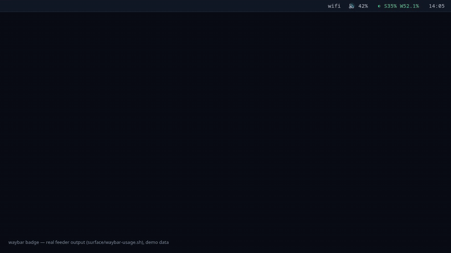
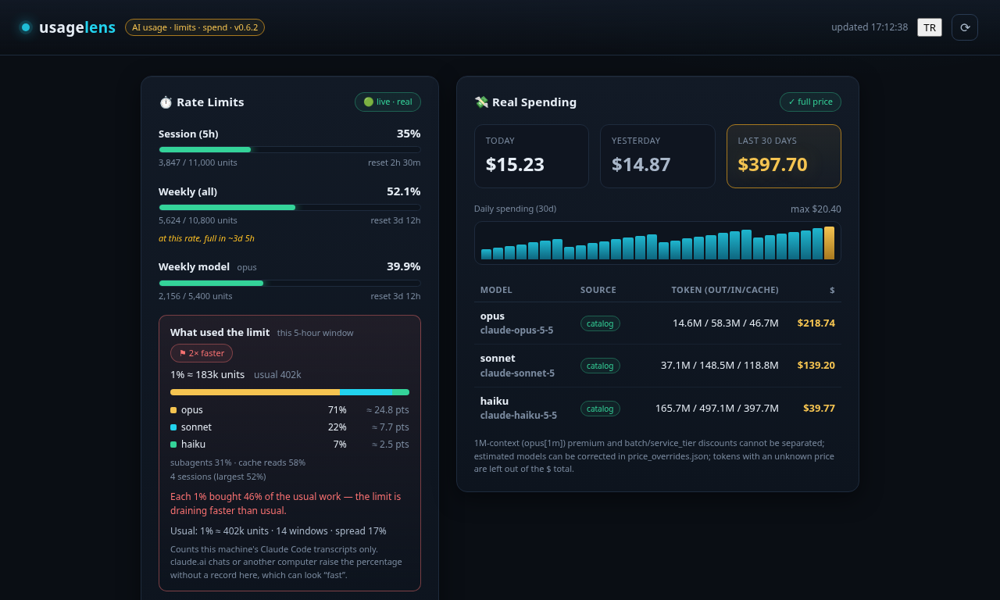

# usagelens

**Your Claude Code limits, spend and "what ate my limit" — on your own desktop, from files
already on your disk.** Formerly *usage-tracker*. Repository: `ihsandeniz/usage-tracker`.



```bash
pipx install git+https://github.com/ihsandeniz/usage-tracker.git && usagelens setup
```

Needs Python 3.9+ (`python3 --version`); on older Pythons pipx stops with an unclear
"cannot determine package name" error.

`setup` walks you through each step and shows exactly what it will write before writing it
(every file is backed up; `usagelens setup --uninstall` undoes it). Then `usagelens panel`
opens the panel at `http://127.0.0.1:8770`. No account, no telemetry, loopback only,
stdlib Python — nothing to compile.

- **Live limits from your next Claude Code reply.** One setup step adds a Claude Code status line hook
  (yours keeps showing if you have one). Claude Code already receives your 5-hour and weekly
  % with every reply; the hook saves it, so no extra request goes to Anthropic's
  rate-limited usage endpoint.
- **Real spend.** Token counts from your transcripts × real model prices: today, 30 days,
  per model. On a subscription that is the API-equivalent value, not your bill.
- **Where you look.** Web panel, waybar badge `◐ S13% W18%`, floating widget, tray icon,
  phone badge, and a CLI (`usagelens usage`, `guard`, `watch --notify`).



## Limit Black Box — not the same as `/usage`

Claude Code's `/usage` shows how your *recent* usage splits across skills, sub-agents, MCP
servers and plugins. The Black Box records every move of the official limit % over whole
windows and tells you when one burned **about 2× faster than your usual** for the same work —
with anonymous evidence (`usagelens kanit`) you can paste into a bug report.

## Other ways to install

| | |
|---|---|
| From a clone (Linux) | `git clone https://github.com/ihsandeniz/usage-tracker && cd usage-tracker && ./setup.sh` — adds waybar, widget and tray steps; `./setup.sh --ui` for a browser window |
| Arch (AUR) | package `usagelens` — **not uploaded yet** |
| Windows | download the `.exe` from [Releases](https://github.com/ihsandeniz/usage-tracker/releases/latest) and double-click it → [docs/WINDOWS.md](docs/WINDOWS.md) |

`usage-tracker` still works as a command name.

## More

- **Full guide** — every surface, other desktops (GNOME, KDE, XFCE, polybar, i3blocks),
  provider keys, settings, HTTP endpoints, security: [docs/GUIDE.md](docs/GUIDE.md)
- CLI reference [docs/CLI.md](docs/CLI.md) · JSON contract [docs/WIRE.md](docs/WIRE.md) ·
  Türkçe [README.tr.md](README.tr.md)
- Inspired by [Pane](https://github.com/ItsJazii/pane), a Windows usage app — usagelens is a
  separate project, not affiliated.

MIT — see [LICENSE](LICENSE).
